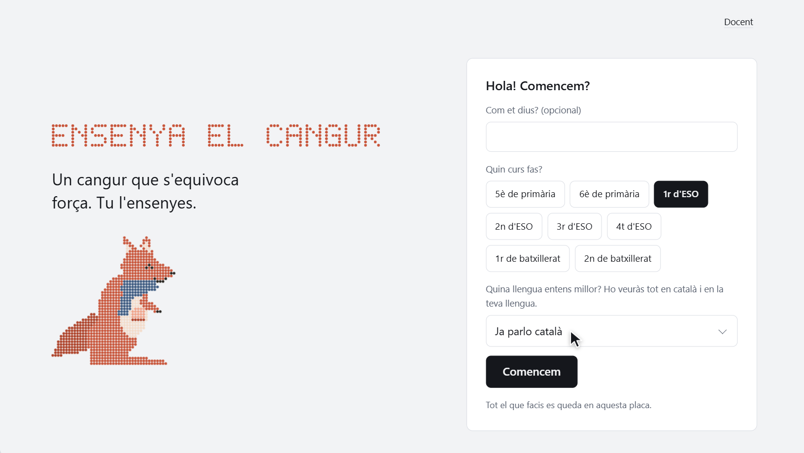

# Ensenya el Cangur · Teach the Kangaroo

**Aprèn matemàtiques ensenyant-les.** Un tutor de matemàtiques que viu en una Arduino UNO Q, funciona sense internet i guarda les dades de cada alumne a la placa.

*[Read it in English](README.md)*

## La idea

Explicar una cosa a algú altre és una de les millors maneres d'entendre-la. Per això, aquí la IA no és el professor. **És el company.**

El model de llenguatge que hi cap a la placa (Qwen3.5 0.8B) encerta els problemes del Cangur més o menys tan sovint com si endevinés. En lloc d'amagar-ho, n'hem fet un personatge: **el Cangur**, un company que sempre s'equivoca primer i necessita l'ajuda de l'alumne.

## Com funciona

1. **Resol.** L'alumne rep un problema real del Cangur, de M3Kang, triat per al seu nivell.
2. **T'has encallat? Puja l'escala.** L'ajuda arriba graó a graó: el tema i un mètode, una pista, una segona pista, un problema semblant i més fàcil, i la solució només si la demana. Mai la resposta primer.
3. **L'has encertat? Ensenya el Cangur.** El Cangur respon malament. L'alumne li escriu una pista per ajudar-lo, sense revelar la resposta. Si la pista és prou bona, el Cangur ho entén, i la seva barra puja a la pantalla i a la matriu LED de la placa.
4. **El següent.** Una puntuació Elo tria el problema següent: prou difícil per aprendre, prou fàcil per continuar.

## Per què importa

- **Privat de sèrie.** Tot funciona a la placa, sense connexió. Sense comptes ni núvol: res surt de l'aula.
- **La llengua no ha de ser la barrera.** Un alumne que encara no llegeix bé el català veu el problema en la seva llengua al costat del català, després amb un botó, i després només en català. Dues puntuacions per alumne diuen al docent quant és llengua i quant és matemàtiques.
- **M3Kang fa la feina pesada.** És la clau de respostes, el mapa de dificultat, la font de problemes semblants i el mateix problema en molts idiomes. El model no ha d'encertar mai.

## A la placa

- S'endolla i, en menys d'un minut, el tutor, els dos models i la matriu LED estan a punt.
- El Cangur llegeix una pista en 11,5 s (mediana); els graons d'ajuda són instantanis.
- `predict.py`, la resposta oficial del repte: **25%** al conjunt de pràctica dels organitzadors, contra el 22,5% del seu baseline. No és una diferència significativa, i ho diem: és justament per això que el model fa d'alumne i no de professor.

Tota la història, com construir-ho, cada mesura i els seus límits: **[`projecte/README.ca.md`](projecte/README.ca.md)**.

## Dades i llicència

M3Kang és només per a recerca: aquest repositori no en conté ni problemes, ni imatges, ni etiquetes ([fitxa del dataset](https://huggingface.co/datasets/qualcomm/M3Kang), Torres-Camps et al., 2026, [arXiv:2601.16218](https://arxiv.org/abs/2601.16218)). Codi amb [llicència MIT](LICENSE), a partir del [repo base](https://github.com/mpous/datathon-UPC-maths-qualcomm-arduino-unoq) dels organitzadors.

## L'equip

Berta Aulet, Irene Miralles, Marc Igual i Berta Vidal · Datathon FME 2026 (UPC), repte de Qualcomm "Math on the Edge".
