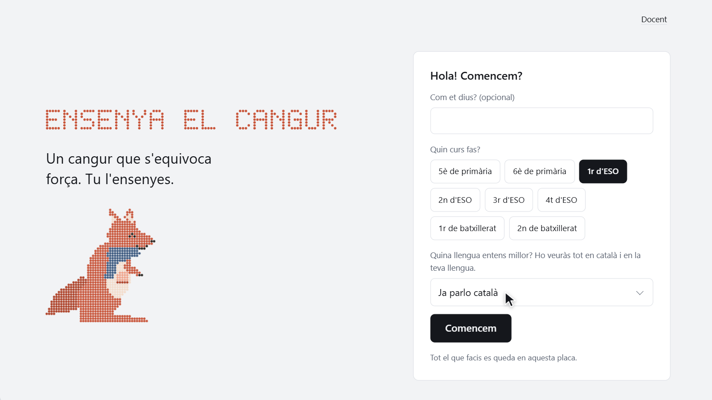

# Ensenya el Cangur · Teach the Kangaroo

**Learn maths by teaching it.** A maths tutor that lives on an Arduino UNO Q, works without internet, and keeps every student's data on the board.

*[Llegeix-ho en català](README.ca.md)* · **[Arduino Project Hub](https://projecthub.arduino.cc/projects/393319ad-8147-4e19-a81e-407f25ed03be/preview)**

**[▶ Watch the demo video](docs/demo.mp4)** (4 min)

## The idea

Explaining something to someone else is one of the best ways to understand it. So here, the AI isn't the teacher. **It's the classmate.**

The language model that fits on the board (Qwen3.5 0.8B) gets Kangaroo problems right about as often as a guess. Instead of hiding that, we made it a character: **the Kangaroo**, a classmate who always gets the problem wrong first and needs the student's help.

## How it works

1. **Solve.** The student gets a real Kangaroo competition problem from M3Kang, chosen for their level.
2. **Stuck? Climb the ladder.** Help comes one rung at a time: the topic and a method, a hint, a second hint, a similar and easier problem, and the solution only if they ask for it. Never the answer first.
3. **Got it? Teach the Kangaroo.** The Kangaroo answers wrong. The student writes a hint to help it, without giving the answer away. If the hint is good enough, the Kangaroo gets it, and its bar goes up on the screen and on the board's LED matrix.
4. **Next.** An Elo rating picks the next problem: hard enough to learn from, easy enough to keep going.

## Why it matters

- **Private by design.** Everything runs on the board, offline. No account, no cloud, nothing leaves the classroom.
- **Language shouldn't be the barrier.** A student who doesn't read Catalan well yet sees the problem in their own language next to Catalan, then with a button, then in Catalan only. Two ratings per student tell the teacher how much is language and how much is maths.
- **M3Kang does the heavy lifting.** It's the answer key, the difficulty map, the source of similar problems and the same problem in many languages. The model never has to be right.

## On the board

- Plug it in: in under a minute the tutor, both models and the LED matrix are ready.
- The Kangaroo reads a hint in 11.5 s (median); help rungs are instant.
- `predict.py`, the official answer for the challenge: **25%** on the organizers' practice set, against 22.5% for their baseline. Not a significant difference, and we say so: it's exactly why the model plays the student, not the teacher.

The full story, how to build it, every measurement and its limits: **[`projecte/README.md`](projecte/README.md)**.

## Data and license

M3Kang is for research use only: this repository holds none of its problems, images or labels ([dataset card](https://huggingface.co/datasets/qualcomm/M3Kang), Torres-Camps et al., 2026, [arXiv:2601.16218](https://arxiv.org/abs/2601.16218)). Code under the [MIT license](LICENSE), built on the organizers' [base repository](https://github.com/mpous/datathon-UPC-maths-qualcomm-arduino-unoq).

## The team

Berta Aulet, Irene Miralles, Marc Igual and Berta Vidal · Datathon FME 2026 (UPC), Qualcomm challenge "Math on the Edge".
