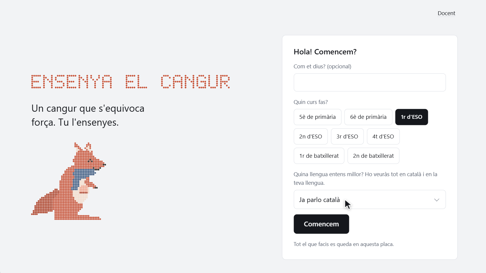

# Ensenya el Cangur (Teach the Kangaroo)

**Aprèn matemàtiques ensenyant-les.** Un tutor de matemàtiques que funciona del tot en una Arduino UNO Q, sense connexió, on la IA no és el professor sinó el company a qui l'alumne ha d'ensenyar. Fet per al repte de Qualcomm "Math on the Edge" de la Datathon FME 2026 (UPC).

*[Read it in English](README.md)* · **[Arduino Project Hub](https://projecthub.arduino.cc/projects/393319ad-8147-4e19-a81e-407f25ed03be/preview)**

> **Estat (15 de novembre de 2026):** funciona en una Arduino UNO Q de 4 GB amb el banc real de M3Kang. Tots els números d'aquest document s'han mesurat a la placa, si no es diu el contrari. El tutor, els dos servidors de models i la matriu LED arrenquen sols quan s'engega la placa.

## Una sessió amb el Cangur



**1. Benvinguda.** L'alumne escriu el seu nom (si vol), el curs (de 5è de primària a 2n de batxillerat) i la llengua que entén millor: català, castellà, anglès, francès, àrab o xinès. La pantalla l'avisa: *"Tot el que facis es queda en aquesta placa."* El Cangur el saluda: *"Hola! Soc el Cangur. Resolem problemes junts? Aviso: jo m'equivoco força, potser m'hauràs d'ajudar!"*

**2. El problema.** Arriba en dos temps: primer l'enunciat i després les opcions, una a una. L'alumne respon amb un clic o amb les tecles A–E. Al costat hi ha el pati del Cangur: el Cangur, dibuixat amb punts com els LED de la placa, damunt d'un camí de 13 llums (tantes com columnes té la matriu), amb una creu en un extrem i un ✓ a l'altre. Un mirall de la matriu LED mostra a la pantalla el mateix que es veu a la placa.

**3. Si s'equivoca, l'escala d'ajuda.** *"No és aquesta. Pots demanar una pista i tornar-ho a provar."* Cada botó puja un graó: *Demana una pista* (el tema i un mètode), *Una altra pista*, un problema semblant i més fàcil per provar abans de veure'n la resposta, i finalment *Ensenya'm la solució*. La pantalla compta les pistes demanades i els intents que queden.

**4. Si l'encerta, ensenya el Cangur.** *"Doncs jo he dit la B… (n'estic un 62 % segur). M'ajudes? Dona'm una pista, però no em diguis la resposta!"* L'alumne li escriu una pista. Si revela la resposta, el Cangur l'avisa i l'intent no es gasta. Si no, *"Aaah, ara ho veig!"*: el Cangur salta pel camí cap al ✓, les llums s'encenen i la matriu LED de la placa ho mostra.

**5. El meu progrés.** Un calaix amb els problemes encertats a la primera, la ratxa, els encerts per tema i la llista de problemes fallats per tornar-los a provar (sense que afecti la puntuació). L'alumne també pot triar el tema que vol practicar.

**6. Un problema meu.** Amb *Tinc un problema meu*, l'alumne enganxa un problema dels deures o d'un llibre, amb les opcions A) … E). El Cangur li diu de quin tema sembla i quin nivell té, i el fan junts pel mateix recorregut, amb un avís sempre visible perquè confirmi la solució amb el professor.

**7. La llengua, al seu ritme.** Al principi, el problema surt en català i en la llengua de l'alumne, un al costat de l'altre. Quan encadena encerts, passa a *Català amb ajuda*, amb el botó *Veure en la meva llengua*, i després a *Només català*. L'àrab es llegeix de dreta a esquerra, es pot canviar de llengua sense perdre el progrés, i tot el que és traducció automàtica s'indica a la pantalla.

**8. Per al docent.** Un panell amb el resum per tema, quantes pistes han convençut el Cangur i quantes s'han rebutjat, els problemes externs a part i, després de 30 respostes per llengua, una estimació de quant li costa la llengua a l'alumne.

**Pensada per a l'aula:** funciona al mòbil i a l'ordinador, segueix el mode clar o fosc del dispositiu, es pot fer servir amb el teclat i amb lector de pantalla, i si es perd la connexió amb la placa ho diu i permet tornar-ho a provar.

## Què fa

Explicar una cosa a algú altre és una de les millors maneres d'entendre-la. El model de llenguatge que hi cap a la placa (Qwen3.5 0.8B) respon els problemes del Cangur gairebé a l'atzar: els organitzadors van mesurar un 22,5% en 40 problemes, menys que respondre sempre "D". Per tant, no pot fer de professor, però sí de **Cangur**, un company que sempre s'equivoca primer i necessita l'ajuda de l'alumne:

1. **L'alumne resol un problema** del banc de M3Kang. M3Kang sap la resposta correcta, així que la correcció és exacta.
2. **Si s'equivoca**, rep ajuda graó a graó: el tema i un mètode; una pista; una segona pista (totes dues del nostre banc de pistes, en ordre); un problema semblant i més fàcil per intentar, sense la resposta; i la solució només si la demana.
3. **Si l'encerta**, ensenya el Cangur, un company fluix que fa el model, que llegeix el problema i la pista en català. El Cangur sempre comença amb una resposta equivocada. L'alumne escriu una pista que no pot revelar la resposta. Una pista que passa el filtre de fuites convenç el Cangur, i la barra de la pantalla i de la matriu LED puja (`KANGAROO_RULE=clean`).
4. **Cada alumne té la seva placa.** Una pista no es mostra mai a ningú més. Només una pista que de debò ha convençut el Cangur en conserva el text, per al docent; tota la resta es compta, sense text.
5. **El problema següent** es tria amb puntuacions Elo (vegeu Puntuacions), perquè sigui prou difícil per aprendre i prou fàcil per continuar.

El model no escriu mai text per a l'alumne: només diu com de probable troba cada lletra, en un sol token, i tot el que "diu" el Cangur és una frase escrita per l'equip. Les pistes surten d'un banc de pistes que hem preparat (dues per problema), i els problemes externs reben pistes de mètode del seu tema. Tot el flux de pistes, en català, és a [`docs/PISTES.md`](../docs/PISTES.md).

### El pont d'idioma

Els problemes de PISA i del Cangur són textos llargs. Un alumne que encara no llegeix bé la llengua de l'aula falla abans de començar la matemàtica. M3Kang té cada problema en molts idiomes amb el mateix `id`, i per això:

- **Tres etapes.** El problema en la llengua de l'alumne al costat del català; després en català amb un botó per veure'l en la seva llengua (cada ús es compta); després només en català. L'alumne avança després de quatre encerts seguits sense fer servir el botó.
- **Llengua o matemàtiques?** L'alumne té dues puntuacions, una per llengua. La diferència estima quant li costa la llengua. Només es mostra al docent després de 30 respostes per llengua, com a interval aproximat, i ningú queda etiquetat: l'alumne tria la llengua, i les dades es queden a la placa.

### Puntuacions

Alumnes i problemes comparteixen una mateixa escala Elo. La probabilitat que un alumne encerti un problema és

```text
P = 0.2 + 0.8 / (1 + 10 ^ ((R_problem − R_student) / 400))
```

on 0,2 és endevinar a cegues entre cinc opcions. Després de cada resposta, la puntuació de l'alumne es mou `K · (resultat − P)`.

- **Els problemes tenen una puntuació fixa**, que posa una sola vegada `prep/build_tutor_db.py`: `1000 + 150 · nivell + 100 · terç de la prova` (les proves del Cangur van de preguntes de 3 punts a preguntes de 5 punts). Les respostes dels alumnes no la mouen mai, de manera que tots els alumnes es mesuren amb la mateixa escala i un alumne no pot desplaçar el banc.
- **Un alumne comença** a `1000 + 150 · nivell`, segons el curs que diu que fa. `K` comença a 160 i baixa fins a 40 (`K = max(40, 160 / (1 + respostes / 8))`): ràpid per trobar el nivell i després estable. Amb alumnes simulats que comencen a 300 punts del seu nivell, una `K = 32` constant encara és a uns 150 punts després de 20 respostes; amb aquest esquema, a uns 65.
- **Només compta la primera resposta**, i demanar la solució compta com a error. Els graons d'ajuda i ensenyar el Cangur no canvien la puntuació.
- **Només els problemes del banc mouen una puntuació.** La seva resposta és l'etiqueta de M3Kang. Els problemes externs (més avall) es desen a part i no la mouen mai.
- **Dues puntuacions per alumne** per al pont d'idioma: `elo_cat` i `elo_origen`. Cada resposta només mou la de la llengua en què s'ha llegit (el català, o la llengua de l'alumne quan era a la pantalla o s'ha fet servir el botó).
- **El problema següent** és el problema del banc no vist amb la `P` més propera a 0,7; després d'un error, un del mateix tema si n'hi ha cap de prou proper.

### Problemes de fora del banc

Un alumne pot escriure el seu propi problema, amb les opcions `A) … E)`. Fa el mateix recorregut que un problema del banc, amb una diferència: ningú en sap la resposta segur.

1. Si és una còpia gairebé exacta d'un problema del banc (similitud d'embeddings ≥ 0,97), es considera el mateix problema, amb la resposta de M3Kang.
2. Si no, el tutor el situa (tema per paraules clau i un nivell estimat a partir dels 5 problemes més semblants del banc) i el harness, el mateix `solve()` que executa `predict.py`, en calcula una resposta en segon pla. Aquesta resposta fa d'etiqueta: la resposta de l'alumne es compara amb ella, l'escala d'ajuda i el Cangur la fan servir, i el pas de la solució la mostra. La resposta no es mostra mai abans que l'alumne resolgui el problema o demani la solució.
3. Aquest avís es manté a la pantalla tota l'estona: *"No podem assegurar les respostes per a problemes externs. Confirma la solució en fonts oficials o amb el teu professor."*
4. El filtre de fuites és més estricte: una pista no pot esmentar cap opció (ni lletra, ni posició, ni valor d'opció), perquè la resposta del harness pot ser incorrecta.
5. L'intent es desa amb `external = 1`. No mou cap puntuació, no compta per a les etapes d'idioma, ni per al resum per temes del docent ni per als recomptes de pistes, i el docent el veu com un recompte a part. Les pistes que s'hi escriuen no es guarden mai.
6. No té pistes del banc, així que els graons 2 i 3 són pistes de mètode del seu tema.
7. Sense cinc opcions llegibles no hi ha res amb què comparar: el tutor només mostra el tema, el nivell estimat i problemes semblants per practicar.

### `predict.py`

El punt d'entrada oficial respon una lletra per problema, com demana el repte. Per sobre del baseline pot: corregir el biaix de lletra del model, tornar a preguntar amb les opcions rotades i fer la mitjana, afegir problemes resolts semblants (RAG), fer que el model escrigui una expressió que calcula Python, respondre la lletra més freqüent quan un problema no té opcions llegibles, i no s'atura mai per un error. Cadascuna d'aquestes opcions és un paràmetre de `config.env`, i totes s'han mesurat a la placa (vegeu Resultats).

**La configuració final** (els valors per defecte de `config.env`): una crida que llegeix la probabilitat de cada lletra, corregida amb el biaix de lletra de la placa (`PREDICT_DEBIAS=auto`, `data/letter_bias.json`); sense rotacions, sense RAG i sense expressió; i la resposta més freqüent del conjunt d'entrenament (`data/priors.json`) quan un problema no té opcions llegibles (`PREDICT_NO_OPTIONS=prior`). Amb els 100 problemes de pràctica dels organitzadors encerta un 25% amb 7,6 s de mitjana (12,2 s el pitjor).

## Arquitectura

| Peça | On s'executa | Què fa |
| --- | --- | --- |
| Pàgina web (`app/index.html`) | El navegador de l'alumne | Mostra el problema, recull la resposta i la pista |
| Tutor (`app/server.py`, `copilot/tutor.py`) | Linux a la placa | El flux, el filtre de fuites, l'Elo, les crides al model |
| Servidor del model de llenguatge, port 8081 | Linux a la placa | Retorna una probabilitat per lletra |
| Servidor d'embeddings, port 8082 | Linux a la placa | Troba problemes semblants (preparació i problemes externs) |
| SQLite (`data/tutor.db`) | Linux a la placa | L'alumne, els intents, les pistes, les puntuacions, els textos dels problemes |
| App d'App Lab (`applab/math-matrix`) | Linux + microcontrolador | Dibuixa la imatge del tutor a la matriu LED de 8x13 |

Com es fa servir M3Kang: com a clau de respostes, com a mapa de dificultat (el nivell i la posició a la prova donen a cada problema una puntuació fixa), com a biblioteca de problemes semblants (embeddings), com el mateix problema en diversos idiomes, i com a base del nostre banc de pistes.

```text
predict.py            punt d'entrada oficial (la mateixa línia de comandes que el repo base)
eval.py               encert i latència, per nivell, tema i idioma
copilot/llm.py        letter_probs(): una probabilitat per a cada lletra de la A a la E
copilot/pipeline.py   solve(): correcció del biaix, rotacions, pressupost de temps
copilot/tutor.py      el flux del tutor
copilot/hintgen.py    la pista d'una frase del model per a un problema extern
copilot/leak.py       revela la resposta una pista?
copilot/elo.py        puntuacions i tria del problema següent
copilot/topics.py     un tema per problema, per paraules clau, i pistes de mètode
copilot/store.py      el fitxer SQLite
copilot/led.py        imatges per a la matriu LED
prep/                 scripts de preparació
sim/students.py       alumnes simulats
app/                  la pàgina web del tutor
applab/math-matrix/   app d'App Lab per a la matriu LED
dashboard/            el dashboard de decisions (Side Challenge Tukey)
tests/                proves, un servidor de model simulat, problemes inventats
docs/SETUP.md         la guia dels organitzadors: muntatge de la placa, models, M3Kang
```

## Com replicar-ho

Partiu d'una placa preparada amb els passos 0 a 12 de [docs/SETUP.md](docs/SETUP.md): llama.cpp compilat, els dos models funcionant com a serveis, `data/train.jsonl` i `data/val.jsonl` a la placa, i `data/index.db` construït. Després, a la placa, des d'aquesta carpeta:

**1. Comproveu que el servidor del model dona el que el projecte necessita** (2 minuts).

```bash
python3 prep/check_model.py
```

Comprova que el servidor dona una probabilitat per a cada lletra, i que una segona crida amb una pista només llegeix la pista.

**2. Mesureu el baseline.**

```bash
python3 eval.py --limit 50 --name baseline
```

**3. Mesureu el biaix de lletra i les respostes més freqüents** (uns 10 minuts) i torneu a mesurar.

```bash
python3 prep/letter_bias.py
```

```bash
python3 eval.py --limit 50 --name debias
```

```bash
python3 eval.py --limit 50 --rotations 2 --name rotations-2
```

Cinquanta problemes només serveixen per descartar. Confirmeu un candidat amb tota la validació amb `--limit 0` (uns 45 minuts) i després poseu `PREDICT_ROTATIONS` a `config.env`.

**4. Construïu la base de dades del tutor.** Primer prepareu les llengües que vulgueu al portàtil (`laptop/prepare_m3kang.py --languages eng,cat,esp,fra,arb,zho --save-images`) i copieu `data/` a la placa.

```bash
python3 prep/build_tutor_db.py --show-topics 50
```

Llegiu els 50 problemes que mostra i reviseu els temes a mà.

**5. Pregunteu cada problema una vegada al Cangur**, en la seva llengua (`KANGAROO_LANG=cat`). Feu-ho durant la nit a la placa (0,5 s per problema en un portàtil amb el mateix model); continua on s'ha aturat. Si canvieu `KANGAROO_LANG`, torneu-lo a executar amb `--redo`.

```bash
python3 prep/kangaroo_baseline.py
```

Després importeu el banc de pistes (`prep/agent/hint_bank.md`: dues pistes ordenades per a cada problema d'entrenament utilitzable, revisades amb `prep/check_agent_output.py`) i mostreu cada pista una vegada al Cangur:

```bash
python3 prep/import_hints.py data/agent_hints.jsonl
python3 prep/kangaroo_agent_hints.py
```

**6. L'experiment de decisió per a les pistes** (aproximadament 1 hora).

```bash
python3 prep/hint_experiment.py --make-template 25
```

Ompliu `data/hints_experiment.jsonl` amb una pista bona, una pista absurda i una pista que revela la resposta per a cada problema, i després:

```bash
python3 prep/hint_experiment.py
```

Si les pistes bones i les absurdes mouen el Cangur igual, la barra no vol dir res. Mantingueu la resta del tutor i valoreu les pistes només per quants alumnes resolen el problema després de veure-les.

**7. Arrenqueu el tutor.**

```bash
python3 app/server.py --host 0.0.0.0
```

Al portàtil, per USB: `adb forward tcp:8090 tcp:8090` i obriu <http://127.0.0.1:8090>.

Perquè arrenqui amb la placa, instal·leu-lo com a servei (demana sudo). L'app de la matriu LED funciona dins d'un contenidor, així que el tutor ha d'escoltar a totes les interfícies:

```bash
TUTOR_HOST=0.0.0.0 ./board/06_install_tutor_service.sh
```

El servei és `math-tutor`, al port 8090.

**8. La matriu LED.** Copieu `applab/math-matrix` a `/home/arduino/ArduinoApps/` a la placa i arrenqueu-la des d'App Lab, com a app per defecte. Llegeix la imatge del tutor i la dibuixa: un interrogant, una creu, un ✓ i la barra del Cangur. Comprovat a la placa, també després d'un reinici.

**9. Alumnes simulats i el dashboard.**

```bash
python3 sim/students.py
```

```bash
python3 dashboard/build.py
```

### Provar-ho sense placa

```bash
python3 -m unittest discover -s tests
```

```bash
python3 tests/demo_data.py --out data/demo
```

```bash
python3 tests/fake_llama.py --answers data/demo/train.jsonl data/demo/val.jsonl
```

Amb els servidors simulats en marxa, construïu una base de dades a partir de `data/demo/` i arrenqueu `app/server.py`. El servidor simulat no és un model de llenguatge i els problemes de prova són inventats: res del que es mesuri amb ells és un resultat.

## Resultats

Mesurats a la placa amb la configuració final, amb el conjunt de pràctica dels organitzadors (`data/demo.jsonl`: 100 problemes, 20 de cada resposta correcta, en anglès i en català).

| Configuració | Encert (interval del 95%) | Lletres dites A/B/C/D/E | Temps mitjà / pitjor |
| --- | --- | --- | --- |
| Baseline dels organitzadors (els seus 40 problemes en anglès) | 22,5% | — | 8,7 / 12,7 s |
| La lletra del model, sense correcció | 22% (15–31%) | 18/7/0/73/2 | 7,6 / 11,9 s |
| **Configuració final: biaix de lletra corregit** | **25% (18–34%)** | 21/24/20/18/17 | 7,6 / 12,2 s |

- **Lletres equilibrades.** Sense la correcció, el model respon D 73 vegades de 100. Amb la correcció, cada lletra surt entre 17 i 24 vegades, a prop de les 20 de cada del conjunt.
- **Ràpid i lluny del límit:** 7,6 s per problema de mitjana i 12,2 s el pitjor, dels 60 s permesos.
- **Triada mesurant.** Totes les alternatives es van executar a la placa abans de triar (`results/ablations.csv`): problemes resolts semblants (RAG), una expressió calculada per Python i la imatge. Cap no va superar aquesta configuració (vegeu Límits coneguts).

**El tutor a la placa:**

- **Filtre de fuites:** va aturar 23 de les 24 pistes que revelaven la resposta i va deixar passar les 48 pistes netes de la mateixa prova.
- **Temps:** el Cangur llegeix una pista en 11,5 s (mediana) i 15,0 s com a màxim. Un problema extern està a punt en uns 23 s. Un graó d'ajuda és instantani.
- **Comprovació de punta a punta** (`prep/tutor_smoke.py`: 4 problemes fallats pels 5 graons d'ajuda, 6 problemes ensenyant el Cangur, 1 problema extern): 67/67 comprovacions superades, amb almenys 2,7 GB de RAM lliure.

### Què han mostrat els alumnes simulats

Són simulacions del mètode, no alumnes reals (`sim/students.py`, 200 alumnes simulats per configuració, un banc de problemes inventat).

- Amb un pas d'Elo constant de 32, un alumne que comença a 300 punts del seu nivell encara és a uns 150 punts després de 20 respostes (de 140 a 172, segons el punt de partida). Amb un pas que comença gran i es va reduint, a uns 65 (de 58 a 84). Un nivell del Cangur són 150 punts. Fem servir el segon.
- Una bretxa d'idioma de 200 punts es mesura com d'uns 160 després de 15 respostes per llengua i d'uns 185 després de 30, i la meitat central dels alumnes va aproximadament de 120 a 260. Per això la bretxa només es mostra després de 30 respostes per llengua, i com a interval.

## Anàlisi d'errors

La configuració final (`demo-debias`) amb els 100 problemes de pràctica dels organitzadors. Els grups de menys de 10 problemes només apunten una direcció.

| Per llengua | Encerts | Encert (interval del 95%) |
| --- | --- | --- |
| Català | 14/50 | 28% (17–42%) |
| Anglès | 11/50 | 22% (13–35%) |

| Per nivell | 0 | 1 | 2 | 3 | 4 | 5 | 6 | 7 |
| --- | --- | --- | --- | --- | --- | --- | --- | --- |
| Encerts | 2/16 | 6/16 | 4/14 | 4/12 | 1/12 | 3/10 | 1/10 | 4/10 |
| Encert | 12,5% | 37,5% | 28,6% | 33,3% | 8,3% | 30% | 10% | 40% |

| Per tema (paraules clau) | Encerts | Encert |
| --- | --- | --- |
| Nombres i divisibilitat | 10/38 | 26,3% |
| Geometria | 3/18 | 16,7% |
| Temps i calendari | 4/12 | 33,3% |
| Aritmètica i problemes d'enunciat | 2/10 | 20% |
| Recompte i combinacions | 2/6 | 33,3% |
| Probabilitat | 1/6 | 16,7% |
| Fraccions, percentatges i proporcions | 0/4 | 0% |
| Lògica, mesura, patrons | 3/6 | 50% |

Què en diem:

- **El model gairebé no llegeix el problema.** Tots els grups són dins de l'interval d'endevinar a l'atzar (20%). El nivell 0, el més fàcil, treu un 12,5%: els problemes més difícils no el fan anar pitjor, perquè no els està resolent. El català treu més que l'anglès, però els intervals se superposen.
- **Els seus errors són una preferència de lletra, no un error de matemàtiques.** Sense la correcció respon D 73 vegades de 100. La correcció ho treu, i és tot el que pot fer: passa respostes equivocades a altres lletres tan sovint com n'arregla (16 guanyats, 13 perduts).
- **La geometria és el tema més fluix amb prou problemes** (3/18). Els problemes de geometria sovint depenen de la figura, que el model no veu mai, i la imatge no va ajudar (4/10).
- **Els problemes sense opcions llegibles** reben la lletra més freqüent. A la nostra primera validació va treure un 24,6%, més o menys el mateix que el model amb opcions.

Per això el projecte fa servir el model com el Cangur, un company a qui ensenyar, i M3Kang com la clau de respostes, en lloc de fer-lo servir de professor.

M3Kang no té camp de tema. Els temes surten de paraules clau (`copilot/topics.py`): és ràpid i fàcil d'explicar, però és aproximat. Un revisor automàtic va considerar correctes 38 de 50 temes, una persona en va revisar 20 a l'atzar i els va trobar tots correctes, i contra un conjunt de referència coincideixen en 65 de 100. Llegiu la taula per temes tenint-ho en compte.

## Límits coneguts

- **El model.** Qwen3.5 0.8B és el model més gran que hi cap a la placa al costat del tutor, i amb els problemes del Cangur gairebé no supera l'atzar. Amb un model millor, `predict.py` funcionaria bé. Ara això afecta directament els problemes que introdueix l'alumne: la seva "resposta correcta" és la del harness, de manera que el tutor pot donar per bona una resposta que no ho és. Per això l'avís es manté a la pantalla en els problemes externs.
- **Una limitació que hem convertit en la idea.** Aquest mateix límit ens ha permès crear el Cangur, el company que s'equivoca i necessita l'ajuda de l'alumne, que és la clau del projecte. Però el conjunt només funciona del tot quan tenim la resposta correcta: els problemes del banc de M3Kang.
- **Pistes dels problemes nous.** Els problemes que introdueix l'alumne reben ara pistes de mètode predefinides segons el tema. La nostra idea és que el model generi la pista a partir de l'enunciat, la solució i alguns exemples del banc (`copilot/hintgen.py`). No ho hem pogut implementar amb èxit per les limitacions del model, i està desactivat.
- **Puntuar les pistes.** La idea és puntuar una pista pel canvi que provoca en la certesa del model sobre la resposta correcta. Ara mateix aquesta mesura també queda afectada pel baix rendiment del model, i per això la barra premia una pista que no reveli la resposta.
- **L'OCR i les figures.** A M3Kang les opcions estan dibuixades a la imatge i les llegim amb OCR. Algunes no es poden llegir (fraccions, opcions que són dibuixos o gràfics): aquests problemes arriben a `predict.py` sense opcions i reben la lletra més freqüent, i el tutor no els fa servir. A més, molts problemes depenen d'una figura que el model de llenguatge no veu mai; vam provar el model de visió a la placa, però amb uns 36 s per problema no millorava la resposta.

## Dades i llicència

M3Kang té una llicència només per a recerca. Aquest repositori no en conté res: ni textos de problemes, ni imatges, ni `index.db`, `tutor.db` o fitxers de pistes. `.gitignore` els exclou, i els scripts els tornen a generar. Els problemes de `data/sample_problems.jsonl` i de `tests/demo_data.py` són inventats.

El codi té llicència MIT (vegeu `LICENSE`). Parteix del repo base dels organitzadors, [mpous/datathon-UPC-maths-qualcomm-arduino-unoq](https://github.com/mpous/datathon-UPC-maths-qualcomm-arduino-unoq).

- **M3Kang**: Torres-Camps et al., 2026, [arXiv:2601.16218](https://arxiv.org/abs/2601.16218). [Fitxa del dataset](https://huggingface.co/datasets/qualcomm/M3Kang).
- **llama.cpp**: [ggml-org/llama.cpp](https://github.com/ggml-org/llama.cpp), llicència MIT.
- **Qwen3.5 0.8B** (GGUF de bartowski) i **bge-small-en-v1.5** (GGUF de CompendiumLabs): vegeu les seves fitxes de model.
- **RapidOCR**: llicència Apache 2.0.

## L'equip

Berta Aulet, Irene Miralles, Marc Igual i Berta Vidal.
