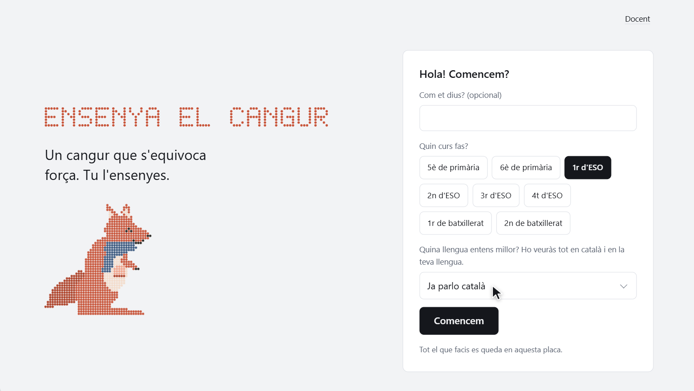

# Ensenya el Cangur (Teach the Kangaroo)

**Learn maths by teaching it.** A maths tutor that runs entirely on an Arduino UNO Q, offline, where the AI isn't the teacher but the classmate the student has to teach. Built for the Qualcomm challenge "Math on the Edge" at the Datathon FME 2026 (UPC).

*[Llegeix-ho en català](README.ca.md)*

> **Status (15 November 2026):** running on an Arduino UNO Q 4 GB with the real M3Kang bank. Every number below was measured on the board unless it says otherwise. The tutor, the two model servers and the LED matrix start on their own when the board boots.

## A session with the Kangaroo



**1. Welcome.** The student types their name (if they want), their school year (from 5th of primary to the last year of secondary) and the language they understand best: Catalan, Spanish, English, French, Arabic or Chinese. The screen tells them: *"Everything you do stays on this board."* The Kangaroo says hello: *"Hi! I'm the Kangaroo. Shall we solve problems together? Fair warning: I get things wrong quite often, so you may have to help me!"*

**2. The problem.** It arrives in two steps: the statement first, then the options one by one. The student answers with a click or the A–E keys. Next to it is the Kangaroo's yard: the Kangaroo, drawn in dots like the board's LEDs, on a road of 13 lamps (as many as the matrix has columns), with a cross at one end and a ✓ at the other. A mirror of the LED matrix shows on screen what the board is showing.

**3. Wrong? The help ladder.** *"That's not it. You can ask for a hint and try again."* Each button climbs one rung: *Ask for a hint* (the topic and a method), *Another hint*, a similar, easier problem to try before seeing its answer, and finally *Show me the solution*. The screen counts the hints asked for and the tries left.

**4. Right? Teach the Kangaroo.** *"Well, I said B… (I'm 62% sure). Will you help me? Give me a hint, but don't tell me the answer!"* The student writes a hint. If it gives the answer away, the Kangaroo says so and the try isn't spent. If not, *"Aah, now I see it!"*: the Kangaroo hops along the road towards the ✓, the lamps light up and the board's LED matrix shows it.

**5. My progress.** A drawer with the problems solved on the first try, the streak, the score per topic and the list of failed problems to try again (without touching the rating). The student can also choose the topic they want to practise.

**6. My own problem.** With *I have a problem of my own*, the student pastes a problem from their homework or a book, with options A) … E). The Kangaroo tells them which topic it looks like and its level, and they work through it the same way, with a warning always on screen to check the solution with their teacher.

**7. Language, at their own pace.** At first the problem shows in Catalan and in the student's language, side by side. After a run of right answers it moves to *Catalan with help*, with a *See it in my language* button, and then to *Catalan only*. Arabic reads right to left, the language can be changed without losing progress, and anything machine-translated is marked on screen.

**8. For the teacher.** A panel with the summary per topic, how many hints convinced the Kangaroo and how many were rejected, outside problems counted apart and, after 30 answers per language, an estimate of how much the language costs the student.

**Made for the classroom:** it works on a phone and on a computer, follows the device's light or dark mode, can be used with the keyboard and a screen reader, and if the link to the board drops it says so and lets the student try again.

## What it does

Explaining something to someone else is one of the best ways to understand it. The language model that fits on the board (Qwen3.5 0.8B) answers Kangaroo problems close to random: the organizers measured 22.5% on 40 problems, below always answering "D". So it can't be the teacher, but it can be **the Kangaroo**, a classmate who always gets it wrong first and needs the student's help:

1. **The student solves a problem** from the M3Kang bank. M3Kang knows the right answer, so checking is exact.
2. **If they're wrong**, they get help one rung at a time: the topic and a method; a hint; a second hint (both from our hint bank, in order); a similar, easier problem to try, without its answer; and the solution only if they ask for it.
3. **If they're right**, they teach the Kangaroo, a weak classmate played by the model, which reads the problem and the hint in Catalan. The Kangaroo always starts with a wrong answer. The student writes a hint that mustn't give the answer away. A hint that passes the leak filter convinces the Kangaroo, and the bar on the screen and on the LED matrix goes up (`KANGAROO_RULE=clean`).
4. **Each student has their own board.** A hint is never shown to anyone else. Only a hint that really convinced the Kangaroo keeps its text, for the teacher; everything else is counted, without text.
5. **The next problem** is chosen with Elo ratings (see Ratings below), so it's hard enough to learn from and easy enough to keep going.

The model never writes text for the student: it only reports how likely it finds each letter, in one token, and everything the Kangaroo "says" is a sentence written by the team. Hints come from a hint bank we prepared (two per problem), and outside problems get method hints for their topic. The whole hint flow, in Catalan, is in [`docs/PISTES.md`](../docs/PISTES.md).

### The language bridge

PISA and Kangaroo problems are long texts. A student who doesn't yet read the classroom language well fails before the maths starts. M3Kang has every problem in many languages with the same `id`, so:

- **Three stages.** The problem in the student's language next to Catalan; then Catalan with a button to see it in their language (each use is counted); then Catalan only. The student moves up after four right answers in a row without the button.
- **Language or maths?** The student has two ratings, one per language. The difference estimates how much the language costs them. It's shown to the teacher only after 30 answers per language, as a rough range, and nobody is labelled: the student chooses the language, and the data stay on the board.

### Ratings

Students and problems share one Elo scale. The chance that a student gets a problem right is

```text
P = 0.2 + 0.8 / (1 + 10 ^ ((R_problem − R_student) / 400))
```

where 0.2 is a blind guess among five options. After each answer the student's rating moves by `K · (result − P)`.

- **Problems have a fixed rating**, set once by `prep/build_tutor_db.py`: `1000 + 150 · level + 100 · third of the paper` (Kangaroo papers go from 3-point to 5-point questions). Students' answers never move it, so every student is measured on the same scale and one student can't shift the bank.
- **A student starts** at `1000 + 150 · level`, from the year they say they're in. `K` starts at 160 and shrinks to 40 (`K = max(40, 160 / (1 + answers / 8))`): fast to find the level, then steady. With simulated students starting 300 points off, a constant `K = 32` is still about 150 points off after 20 answers; this schedule, about 65.
- **Only the first answer counts**, and asking for the solution counts as wrong. Help rungs and teaching the Kangaroo don't change the rating.
- **Only bank problems move a rating.** Their answer is M3Kang's label. Outside problems (below) are stored apart and never move it.
- **Two ratings per student** for the language bridge: `elo_cat` and `elo_origen`. Each answer moves only the one for the language it was read in (Catalan, or the student's language when it was on screen or the button was used).
- **The next problem** is the unseen bank problem whose `P` is closest to 0.7; after a wrong answer, one of the same topic if there's one close enough.

### Problems from outside the bank

A student can type their own problem, with its options `A) … E)`. It goes through the same path as a bank problem, with one difference: nobody knows its answer for sure.

1. If it's a near copy of a bank problem (embedding similarity ≥ 0.97), it's treated as the same problem, with M3Kang's answer.
2. Otherwise the tutor places it (topic from keywords, a level estimated from the 5 most similar bank problems) and the harness, the same `solve()` that `predict.py` runs, works out an answer in the background. That answer plays the label: the student's answer is checked against it, the help ladder and the Kangaroo use it, and the solution step shows it. The answer is never shown before the student solves the problem or asks for the solution.
3. This warning stays on screen the whole time: *"No podem assegurar les respostes per a problemes externs. Confirma la solució en fonts oficials o amb el teu professor."*
4. The leak filter is stricter: a hint may name no option at all (no letter, position or option value), because the harness's answer may be wrong.
5. The attempt is stored with `external = 1`. It moves no rating, doesn't count towards the language stages, the teacher's per-topic summary or the hint counts, and the teacher sees it as a separate count. Hints written for it are never kept.
6. It has no hints in the bank, so help rungs 2 and 3 are method hints for its topic.
7. Without five readable options there's nothing to check against: the tutor only shows the topic, the estimated level and similar problems to practise.

### `predict.py`

The official entry point answers one letter per problem, as the challenge requires. On top of the baseline it can: correct the model's letter bias, ask again with the options rotated and average, add similar solved problems (RAG), have the model write an expression that Python computes, answer the most common letter when a problem has no readable options, and it never stops on an error. Each of these is a setting in `config.env`, and each was measured on the board (see Results).

**The final configuration** (the defaults in `config.env`): one call that reads the probability of each letter, corrected with the board's letter bias (`PREDICT_DEBIAS=auto`, `data/letter_bias.json`); no rotations, no RAG, no expression; and the most common answer in the training set (`data/priors.json`) when a problem has no readable options (`PREDICT_NO_OPTIONS=prior`). On the organizers' 100 practice problems it answers 25% in 7.6 s on average (worst 12.2 s).

## Architecture

| Piece | Runs on | What it does |
| --- | --- | --- |
| Web page (`app/index.html`) | The student's browser | Shows the problem, takes the answer and the hint |
| Tutor (`app/server.py`, `copilot/tutor.py`) | Linux on the board | The flow, the leak filter, Elo, calls to the model |
| Language model server, port 8081 | Linux on the board | Returns a probability per letter |
| Embedding server, port 8082 | Linux on the board | Finds similar problems (preparation, and outside problems) |
| SQLite (`data/tutor.db`) | Linux on the board | The student, attempts, hints, ratings, problem texts |
| App Lab app (`applab/math-matrix`) | Linux + microcontroller | Draws the tutor's picture on the 8x13 LED matrix |

How M3Kang is used: as the answer key, as a difficulty map (level and position in the paper give each problem a fixed rating), as a library of similar problems (embeddings), as the same problem in several languages, and as the base of our hint bank.

```text
predict.py            official entry point (same command line as the base repository)
eval.py               accuracy and latency, by level, topic and language
copilot/llm.py        letter_probs(): a probability for each letter A to E
copilot/pipeline.py   solve(): bias correction, rotations, time budget
copilot/tutor.py      the tutor's flow
copilot/hintgen.py    the model's one-sentence hint for an outside problem
copilot/leak.py       does a hint give the answer away?
copilot/elo.py        ratings and the choice of the next problem
copilot/topics.py     a topic per problem, from keywords, and method hints
copilot/store.py      the SQLite file
copilot/led.py        pictures for the LED matrix
prep/                 preparation scripts
sim/students.py       simulated students
app/                  the tutor's web page
applab/math-matrix/   App Lab app for the LED matrix
dashboard/            the decisions dashboard (Side Challenge Tukey)
tests/                tests, a stand-in model server, invented problems
docs/SETUP.md         the organizers' guide: board setup, models, M3Kang
```

## How to replicate it

Start from a board set up with steps 0 to 12 of [docs/SETUP.md](docs/SETUP.md): llama.cpp built, both models running as services, `data/train.jsonl` and `data/val.jsonl` on the board, and `data/index.db` built. Then, on the board, from this folder:

**1. Check the model server gives what the project needs** (2 minutes).

```bash
python3 prep/check_model.py
```

It checks that the server reports a probability for each letter, and that a second call with a hint only reads the hint.

**2. Measure the baseline.**

```bash
python3 eval.py --limit 50 --name baseline
```

**3. Measure the letter bias and the most common answers** (about 10 minutes), then measure again.

```bash
python3 prep/letter_bias.py
```

```bash
python3 eval.py --limit 50 --name debias
```

```bash
python3 eval.py --limit 50 --rotations 2 --name rotations-2
```

Fifty problems only rule things out. Confirm a candidate on the whole validation set with `--limit 0` (about 45 minutes), then set `PREDICT_ROTATIONS` in `config.env`.

**4. Build the tutor's database.** Prepare the languages you want on your laptop first (`laptop/prepare_m3kang.py --languages eng,cat,esp,fra,arb,zho --save-images`) and copy `data/` over.

```bash
python3 prep/build_tutor_db.py --show-topics 50
```

Read the 50 problems it prints, and check the topics by hand.

**5. Ask the Kangaroo every problem once**, in its language (`KANGAROO_LANG=cat`). Run it overnight on the board (0.5 s per problem on a laptop with the same model); it continues where it stopped. If you change `KANGAROO_LANG`, run it again with `--redo`.

```bash
python3 prep/kangaroo_baseline.py
```

Then import the hint bank (`prep/agent/hint_bank.md`: two ordered hints per usable training problem, checked with `prep/check_agent_output.py`) and show each hint to the Kangaroo once:

```bash
python3 prep/import_hints.py data/agent_hints.jsonl
python3 prep/kangaroo_agent_hints.py
```

**6. The go / no-go experiment for the hints** (about 1 hour).

```bash
python3 prep/hint_experiment.py --make-template 25
```

Fill in `data/hints_experiment.jsonl` with a good hint, a nonsense hint and a hint that gives the answer away for each problem, then:

```bash
python3 prep/hint_experiment.py
```

If good and nonsense hints move the Kangaroo alike, the bar means nothing. Keep the rest of the tutor and judge hints only by how many students solve the problem after seeing them.

**7. Start the tutor.**

```bash
python3 app/server.py --host 0.0.0.0
```

On your laptop, over USB: `adb forward tcp:8090 tcp:8090`, then open <http://127.0.0.1:8090>.

To start it with the board, install it as a service instead (it asks for sudo). The LED matrix app runs in a container, so the tutor has to listen on every interface:

```bash
TUTOR_HOST=0.0.0.0 ./board/06_install_tutor_service.sh
```

The service is `math-tutor`, on port 8090.

**8. The LED matrix.** Copy `applab/math-matrix` to `/home/arduino/ArduinoApps/` on the board and start it from App Lab, as the default app. It reads the tutor's picture and draws it: a question mark, a cross, a tick and the Kangaroo's bar. Checked on the board, also after a reboot.

**9. Simulated students and the dashboard.**

```bash
python3 sim/students.py
```

```bash
python3 dashboard/build.py
```

### Try it without a board

```bash
python3 -m unittest discover -s tests
```

```bash
python3 tests/demo_data.py --out data/demo
```

```bash
python3 tests/fake_llama.py --answers data/demo/train.jsonl data/demo/val.jsonl
```

With the stand-in servers running, build a database from `data/demo/` and start `app/server.py`. The stand-in is not a language model and the demo problems are invented: nothing measured with them is a result.

## Results

Measured on the board with the final configuration, on the organizers' practice set (`data/demo.jsonl`: 100 problems, 20 with each right answer, in English and Catalan).

| Configuration | Accuracy (95% interval) | Letters said A/B/C/D/E | Mean / worst time |
| --- | --- | --- | --- |
| Organizers' baseline (their 40 English problems) | 22.5% | — | 8.7 / 12.7 s |
| The model's letter, no correction | 22% (15–31%) | 18/7/0/73/2 | 7.6 / 11.9 s |
| **Final configuration: letter bias corrected** | **25% (18–34%)** | 21/24/20/18/17 | 7.6 / 12.2 s |

- **Balanced letters.** Without the correction the model answers D 73 times out of 100. With it, each letter comes up between 17 and 24 times, close to the 20 of each in the set.
- **Fast and far from the limit:** 7.6 s per problem on average and 12.2 s at worst, against the 60 s allowed.
- **Chosen by measuring.** Every alternative was run on the board before choosing (`results/ablations.csv`): similar solved problems (RAG), an expression computed by Python and the image. None beat this configuration (see Known limits).

**The tutor on the board:**

- **Leak filter:** it stopped 23 of the 24 hints that gave the answer away, and let all 48 clean hints of the same test through.
- **Time:** the Kangaroo reads a hint in 11.5 s (median) and 15.0 s at worst. An outside problem is ready in about 23 s. A help rung is instant.
- **End-to-end check** (`prep/tutor_smoke.py`: 4 failed problems through the 5 help rungs, 6 problems teaching the Kangaroo, 1 outside problem): 67/67 checks passed, with at least 2.7 GB of RAM free.

### What the simulated students showed

These are simulations of the method, not real students (`sim/students.py`, 200 simulated students per setting, an invented problem bank).

- With a constant Elo step of 32, a student who starts 300 points from their level is still about 150 points off after 20 answers (140 to 172, depending on the starting point). With a step that starts large and shrinks, about 65 (58 to 84). One Kangaroo level is 150 points. We use the second.
- A language gap of 200 points is measured as about 160 after 15 answers per language and about 185 after 30, and the middle half of students spans roughly 120 to 260. That's why the gap is shown only after 30 answers per language, and as a range.

## Error analysis

The final configuration (`demo-debias`) on the organizers' 100 practice problems. Groups under 10 problems only point a direction.

| By language | Right | Accuracy (95% interval) |
| --- | --- | --- |
| Catalan | 14/50 | 28% (17–42%) |
| English | 11/50 | 22% (13–35%) |

| By level | 0 | 1 | 2 | 3 | 4 | 5 | 6 | 7 |
| --- | --- | --- | --- | --- | --- | --- | --- | --- |
| Right | 2/16 | 6/16 | 4/14 | 4/12 | 1/12 | 3/10 | 1/10 | 4/10 |
| Accuracy | 12.5% | 37.5% | 28.6% | 33.3% | 8.3% | 30% | 10% | 40% |

| By topic (keywords) | Right | Accuracy |
| --- | --- | --- |
| Numbers and divisibility | 10/38 | 26.3% |
| Geometry | 3/18 | 16.7% |
| Time and calendar | 4/12 | 33.3% |
| Arithmetic and word problems | 2/10 | 20% |
| Counting and combinations | 2/6 | 33.3% |
| Probability | 1/6 | 16.7% |
| Fractions, percentages and ratios | 0/4 | 0% |
| Logic, measurement, patterns | 3/6 | 50% |

What this says:

- **The model barely reads the problem.** Every group sits inside the interval of random guessing (20%). Level 0, the easiest, gets 12.5%: harder problems don't make it worse, because it isn't solving them. Catalan scores higher than English, but the intervals overlap.
- **Its errors are a letter preference, not a maths mistake.** Without the correction it answers D 73 times out of 100. The correction removes that, and that's all it can do: it moves wrong answers to other letters as often as it fixes them (16 won, 13 lost).
- **Geometry is the weakest topic with enough problems** (3/18). Geometry problems often depend on the figure, which the model never sees, and the image didn't help (4/10).
- **Problems without readable options** get the most common letter. That scored 24.6% on our first validation set, about as good as the model with options.

This is why the project uses the model as the Kangaroo, a classmate to teach, and M3Kang as the answer key, rather than as a teacher.

M3Kang has no topic field. Topics come from keywords (`copilot/topics.py`): fast and easy to explain, but rough. An automatic reviewer judged 38 of 50 topics right, a person checked 20 at random and found them all right, and against a reference set they match 65 of 100. Read the topic table with that in mind.

## Known limits

- **The model.** Qwen3.5 0.8B is the biggest model that fits on the board next to the tutor, and on Kangaroo problems it barely beats guessing. A better model would make `predict.py` work well. Today this hits problems typed in by the student directly: their "right answer" is the harness's, so the tutor can mark as right an answer that isn't. That's why the warning stays on screen for outside problems.
- **A weakness we turned into the idea.** That same limit gave us the Kangaroo, the classmate who gets it wrong and needs the student's help, which is the core of the project. But the whole flow only works when we know the right answer: problems from the M3Kang bank.
- **Hints for new problems.** Problems typed in by the student now get predefined method hints for their topic. Our plan was for the model to write a hint from the statement, the solution and a few examples from the bank (`copilot/hintgen.py`). We couldn't make it work well within the model's limits, so it's off.
- **Scoring hints.** The idea is to score a hint by how much it changes the model's certainty in the right answer. Right now that measure is also limited by the model's low performance, so the bar rewards a hint that doesn't give the answer away.
- **OCR and figures.** In M3Kang the options are drawn in the image, and we read them with OCR. Some can't be read (fractions, options that are drawings or charts): those problems reach `predict.py` without options and get the most common letter, and the tutor doesn't use them. Many problems also depend on a figure the language model never sees; we tried the board's vision model, but at about 36 s per problem it didn't improve the answer.

## Data and license

M3Kang is licensed for research use only. This repository holds none of it: no problem texts, images, `index.db`, `tutor.db` or hint files. `.gitignore` excludes them, and the scripts rebuild them. The problems in `data/sample_problems.jsonl` and `tests/demo_data.py` are invented.

The code is under the MIT license (see `LICENSE`). It builds on the organizers' base repository, [mpous/datathon-UPC-maths-qualcomm-arduino-unoq](https://github.com/mpous/datathon-UPC-maths-qualcomm-arduino-unoq).

- **M3Kang**: Torres-Camps et al., 2026, [arXiv:2601.16218](https://arxiv.org/abs/2601.16218). [Dataset card](https://huggingface.co/datasets/qualcomm/M3Kang).
- **llama.cpp**: [ggml-org/llama.cpp](https://github.com/ggml-org/llama.cpp), MIT license.
- **Qwen3.5 0.8B** (GGUF by bartowski) and **bge-small-en-v1.5** (GGUF by CompendiumLabs): see their model cards.
- **RapidOCR**: Apache 2.0 license.

## The team

Berta Aulet, Irene Miralles, Marc Igual and Berta Vidal.
